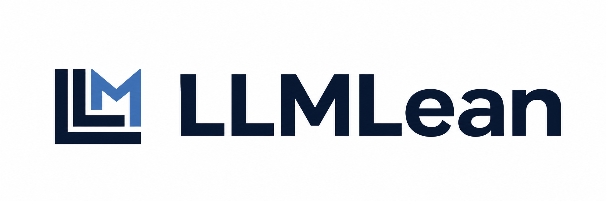
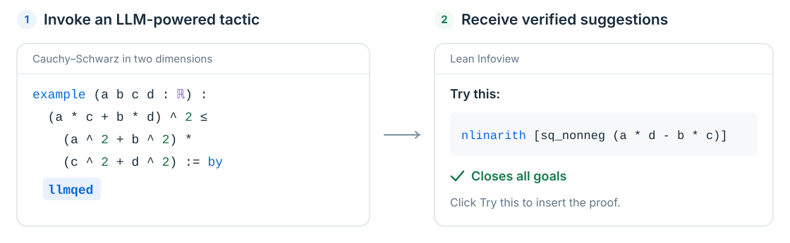
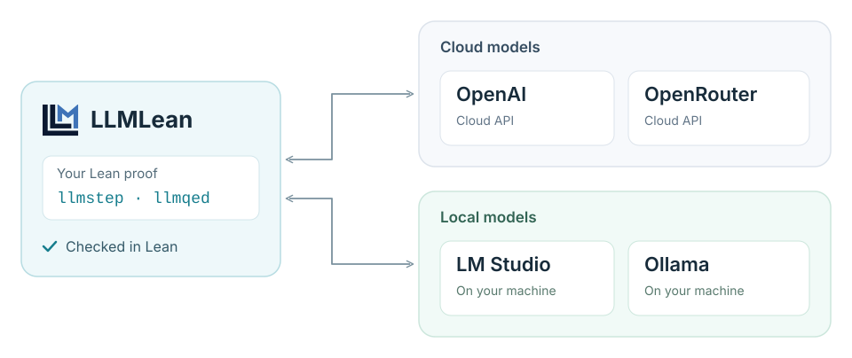
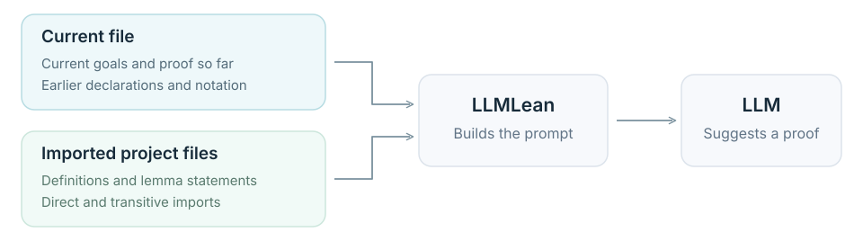

<h1 align="center">
  <picture>
    <source media="(prefers-color-scheme: dark)" srcset="img/logo-dark.png">
    
  </picture>
</h1>

<p align="center">
  LLM-powered automation for Lean.
</p>

<p align="center">
  <a href="lean-toolchain"></a>
  <a href="https://github.com/cmu-l3/llmlean/actions/workflows/ci.yml"></a>
  <a href="LICENSE"></a>
</p>

<p align="center">
  <a href="#installation">Installation</a> ·
  <a href="#setup">Providers</a> ·
  <a href="#usage">Usage</a> ·
  <a href="LLMleanDemo/README.md">Demo</a> ·
  <a href="docs/customization.md">Configuration</a>
</p>

<p align="center">
  LLMLean integrates LLMs and Lean for tactic suggestions and proof completion.
</p>

<p align="center">
  <picture>
    <source media="(prefers-color-scheme: dark)" srcset="img/usage-dark.svg">
    
  </picture>
</p>

<p align="center">
  You can use an LLM running on your laptop or in the cloud.
</p>

<p align="center">
  <picture>
    <source media="(prefers-color-scheme: dark)" srcset="img/architecture-dark.svg">
    
  </picture>
</p>

## Usage

LLMLean is used interactively in [VS Code](https://code.visualstudio.com/) with the
Lean extension. Suggestions appear in Lean's Infoview.

### Suggest the next step

Use `llmstep` for a tactic that makes progress on the current goals:

```lean
example (n : Nat) : n + 0 = n := by
  llmstep
```

You can also give a prefix, such as `llmstep "apply "`.

### Complete a proof

Use `llmqed` for a completion that closes all remaining goals:

```lean
example (P Q : Prop) (h : P ∧ Q) : Q ∧ P := by
  llmqed
```

Both tactics check suggestions in Lean and can retry with Lean's error messages.
Click **Try this** in the Infoview to insert a suggestion into your proof.

The [demo project](LLMleanDemo/README.md) has examples to try in VS Code, with worked solutions.

## Installation

Requires Lean **4.35.0**.

1. Add LLMLean to your project's `lakefile.lean`:

   ```lean
   require llmlean from git
     "https://github.com/cmu-l3/llmlean.git"
   ```

2. Run `lake update llmlean` from your project directory.

3. Import LLMLean in your Lean file:

   ```lean
   import LLMlean
   ```

## Setup

OpenAI with `gpt-6-luna` is the default.

<details open>
<summary><strong>OpenAI</strong> · Cloud models · Default</summary>

Get an [OpenAI API key](https://platform.openai.com/api-keys) and set it in your terminal:

```sh
export OPENAI_API_KEY="<your-api-key>"
```

No configuration file is needed. To customize the model, create `llmlean.toml`
in your project directory:

```toml
provider = "openai"
model = "gpt-6-luna"
```

Quit VS Code, then open your project from the same terminal so that it picks up the key:

```sh
code .
```

</details>

<details>
<summary><strong>OpenRouter</strong> · Cloud models</summary>

Set your OpenRouter key in your terminal:

```sh
export OPENROUTER_API_KEY="<your-api-key>"
```

Create `llmlean.toml` in your project directory, using a model identifier from OpenRouter:

```toml
provider = "openrouter"
model = "<model-id-listed-by-the-provider>"
```

Quit VS Code, then run `code .` from the same terminal so that it picks up the key.

</details>

<details>
<summary><strong>LM Studio</strong> · Local models</summary>

Load a model in LM Studio and start its local server. Create `llmlean.toml` in your
project directory, using the model identifier shown in the **Developer** tab:

```toml
provider = "local"
base_url = "http://localhost:1234/v1"
model = "qwen/qwen3.5-9b"
reasoning_effort = "none"
```

No API key is needed for the default local server. For this model,
`reasoning_effort = "none"` turns thinking off for LLMLean requests.

</details>

<details>
<summary><strong>Ollama</strong> · Local models</summary>

Install and start [Ollama](https://ollama.com/), then pull a model:

```sh
ollama pull qwen3.5:9b-q4_K_M
```

Create `llmlean.toml` in your project directory:

```toml
provider = "local"
model = "qwen3.5:9b-q4_K_M"
```

No API key is needed.

</details>

For other servers and connection details, see the [provider guide](docs/other_providers.md).
Local servers must support the Responses API.

## Project context

LLMLean uses context from both the current file and imported files in your project.
Along with the current goals and proof so far, it includes earlier definitions,
lemma statements, and notation to help the model use results you have already proved.

<p align="center">
  <picture>
    <source media="(prefers-color-scheme: dark)" srcset="img/context-dark.svg">
    
  </picture>
</p>

Use `llmcontext` inside a proof to preview the prompt without making a model request.
See [context selection](docs/customization.md#context-selection) for budgets and comparison modes.

## Documentation

| Guide | Contents |
| --- | --- |
| [Demo project](LLMleanDemo/README.md) | Examples and worked solutions in VS Code |
| [Configuration](docs/customization.md) | Models, generation budgets, project context, and Lean options |
| [Benchmarks](docs/benchmarks.md) | Experiments comparing context policies and proof completion |
| [Providers](docs/other_providers.md) | Cloud APIs and local server configuration |
| [Migration](docs/migration.md) | Updating from older versions |

## Development

Issues and pull requests are welcome. To run the checks from the repository directory:

```sh
lake build llmlean
lake test
python3 scripts/test_transport.py
```

Mathlib examples are in [LLMleanTest](LLMleanTest).

Run `python3 scripts/benchmark_context.py` for offline context benchmarks covering
long proofs, many declarations, and direct/transitive imports. `--prove` opts into
model-backed comparisons using your configured provider.

## Citation

LLMLean evolved from [llmstep](https://github.com/wellecks/llmstep). If you would like
to cite LLMLean in an academic context, please cite the
[llmstep paper](https://mathai2023.github.io/papers/40.pdf)
(NeurIPS 2023 Workshop on MATH-AI):

```bibtex
@inproceedings{welleck2023llmstep,
  title = {{LLMSTEP}: {LLM} proofstep suggestions in {Lean}},
  author = {Welleck, Sean and Saha, Rahul},
  booktitle = {NeurIPS 2023 Workshop on MATH-AI},
  year = {2023},
  url = {https://mathai2023.github.io/papers/40.pdf}
}
```

## License

[MIT](LICENSE).
